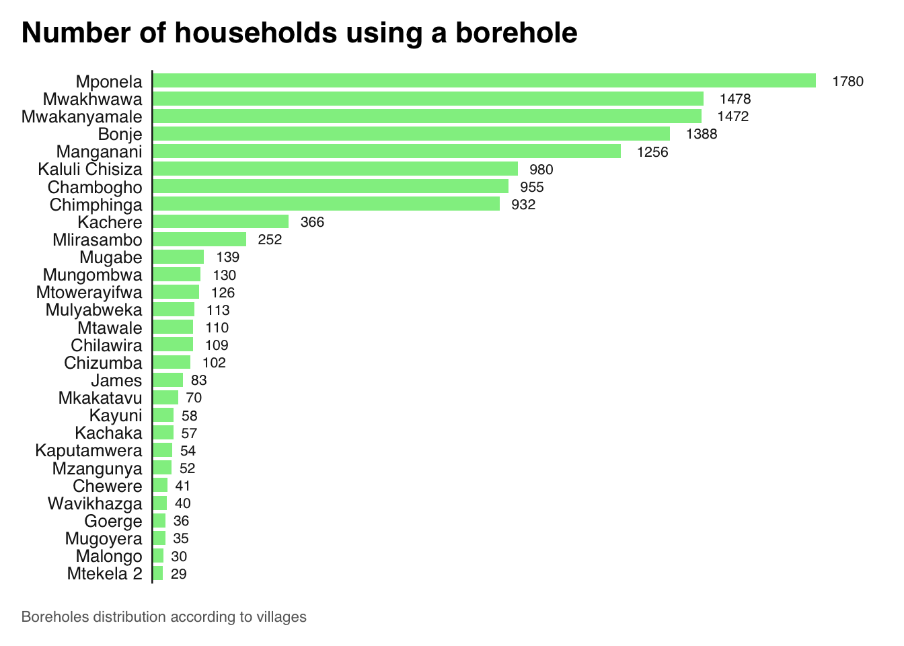

# boreholefuncmwi

The goal of `boreholefuncmwi` is to provide access to data which were
collected in the Karonga district (North of Malawi) and contains answers
from a 20-minute questionnaire about boreholes. The questionnaire was
installed on
[koboToolbox](https://openwashdata.github.io/boreholefuncmwi/www.kobotoolbox.org)
to collect borehole functionality data from 300 respondents aged 18 and
above.

## Installation

You can install the development version of boreholefuncmwi from
[GitHub](https://github.com/) with:

``` r

# install.packages("devtools")
devtools::install_github("openwashdata/boreholefuncmwi")
```

``` r

## Run the following code in console if you don't have the packages
## install.packages(c("dplyr", "knitr", "readr", "stringr", "gt", "kableExtra"))
library(dplyr)
library(knitr)
library(readr)
library(stringr)
library(gt)
library(kableExtra)
```

Alternatively, you can download the individual datasets as a CSV or XLSX
file from the table below.

| dataset | CSV | XLSX |
|:---|:---|:---|
| boreholefuncmwi | [Download CSV](https://github.com/openwashdata/boreholefuncmwi/raw/main/inst/extdata/boreholefuncmwi.csv) | [Download XLSX](https://github.com/openwashdata/boreholefuncmwi/raw/main/inst/extdata/boreholefuncmwi.xlsx) |

## Data

``` r

library(boreholefuncmwi)
```

### boreholefuncmwi

The dataset `boreholefuncmwi` contains data about borehole’s management
in the North of Malawi. Questions included in the questionnaire are for
example about the borehole maintenance contributions from the community,
the availability of borehole spare parts, tariff collection frequency
and presence of a service provider. It has 108 observations and 17
variables.

``` r

boreholefuncmwi |> 
  head(3) |> 
  gt::gt() |>
  gt::as_raw_html()
```

| id | date | role | committee_members | last_meeting_participants | annual_budget | village | number_households | tariff_costs_consider | tariff_frequency | tariff_amount | total_money | tariff_hh_number | distance_materials | service_provider | preventive_maintenance | functional_status |
|---:|---:|:---|---:|---:|---:|:---|---:|:---|:---|---:|---:|---:|:---|---:|---:|---:|
| 1 | 2023-05-03 | Area Mechanic | NA | NA | 1000001 | Mulyabweka | 39 | No tarrif system set | None | 0 | 0 | 0 | \>20 km away | 0 | 0 | 0 |
| 2 | 2023-05-07 | Community member | NA | NA | 50000 | Mlirasambo | 48 | No tarrif system set | None | 0 | 0 | 0 | \>20 km away | 0 | 0 | 0 |
| 3 | 2023-05-08 | Community member | NA | NA | 50000 | James | 59 | No tarrif system set | None | 0 | 4000 | 0 | \>20 km away | 1 | 0 | 0 |

For an overview of the variable names, see the following table.

| variable_name | variable_type | description |
|:---|:---|:---|
| id | integer | Identification number of the observation |
| date | date | Date the survey was filled out |
| role | categorical | Main role of the respondent. Options include ‘Area Mechanic’, ‘Chief/Village Headman’, ‘Community member’, ‘Councilor’, ‘Head teacher/Teacher’, ‘HSA/Health officer’, ‘Hand pump borehole committee chair’, ‘Hand pump borehole committee member’, ‘Hand pump borehole owner’, ‘Water Seller’, and ‘Water User Association/Water Board member’ |
| committee_members | integer | How many people are on the Hand pump borehole Committee as of 2023? |
| last_meeting_participants | integer | How many community members attended the last meeting? (Label 99 for unknown number of attendants) |
| annual_budget | integer | How much money in Malawi Kwacha do you need to manage this borehole without financial problems annually? |
| village | categorical | Name of the village |
| number_households | integer | How many households use this hand pump borehole? |
| tariff_costs_consider | categorical | What costs were considered when setting the tariff or user fee? Options including Maintenance costs, Operation costs - e.g. salary of the water seller, Total replacement cost for the system, Set by local government, and Bill payments. |
| tariff_frequency | categorical | How often is the tariff/user fee collected? Including per month, per 2 months, per quarter, per year and when required for repairs. |
| tariff_amount | integer | How much is the tariff/user fee in Kwacha? |
| total_money | integer | How much money in Malawi Kwacha do you source to support operations and maintenance annually? |
| tariff_hh_number | integer | How many households in the community paid a water fee the last time it was collected? |
| distance_materials | categorical | How far away are/were the materials you use for hand pump borehole repairs? Options include ‘\>20km’, ‘0-20km’, ‘within community’, and ‘don’t know’. |
| service_provider | categorical | Is there a service provider or someone responsible for operating and/or maintaining this hand pump borehole or water system? Yes for 1 and No for 0. |
| preventive_maintenance | categorical | Do you conduct preventive maintenance? Yes for 1 and No for 0. |
| functional_status | categorical | Functional status of the borehole. Functional for 1, Not functional for 0 (including ‘Partially functional but in need of repair’, ‘Not functional’) |

## Example

It can be interesting to analyse the numbers of households who draw
water from a borehole in each village. Here is a plot showing the
distribution of boreholes’ use across villages.

``` r

library(boreholefuncmwi)
library(unhcrthemes)
library(ggplot2)
borehole_user <- boreholefuncmwi %>%
  group_by(village) %>%
  summarise(number_households = sum(number_households, na.rm = TRUE))

ggplot(borehole_user) +
  geom_col(aes(
    x = number_households,
    y = reorder(village, number_households)
  ),
  fill = "lightgreen",  # Change the color here to light green
  width = 0.8
  ) +
  geom_text(aes(
    x = number_households,
    y = reorder(village, number_households),
    label = round(number_households)
  ),
  hjust = -0.5,
  size = 8 / .pt
  ) +
  labs(
    title = "Number of households using a borehole",
    caption = "Boreholes distribution according to villages"
    
  ) +
  scale_x_continuous(expand = expansion(c(0, 0.1))) +
  theme_unhcr(
    grid = FALSE,
    axis = "y",
    axis_title = FALSE,
    axis_text = "y"
  )
```



## Capstone Project

This dataset is shared as part of a capstone project in [Data Science
for openwashdata](https://ds4owd-001.github.io/website/). For more
information about the project and to explore further insights, please
visit the project page at
<https://ds4owd-001.github.io/project-myesaya/>

## License

Data are available as
[CC-BY](https://github.com/openwashdata/boreholefuncmwi/blob/main/LICENSE.md).

## Citation

Published by openwashdata, <https://openwashdata.org>.

Please cite this package using:

``` r

citation("boreholefuncmwi")
#> To cite package 'boreholefuncmwi' in publications use:
#> 
#>   Yesaya M, Preisig J, Kayira H, Zhong M (2024). "boreholefuncmwi:
#>   Analysis of boreholes' functionality in Northern Malawi."
#>   doi:10.5281/zenodo.12635354
#>   <https://doi.org/10.5281/zenodo.12635354>,
#>   <https://github.com/openwashdata/boreholefuncmwi>.
#> 
#> A BibTeX entry for LaTeX users is
#> 
#>   @Misc{yesaya_etall:2024,
#>     title = {boreholefuncmwi: Analysis of boreholes' functionality in Northern Malawi},
#>     author = {Mabvuto Yesaya and Juliette Preisig and Hastings Kayira and Mian Zhong},
#>     year = {2024},
#>     doi = {10.5281/zenodo.12635354},
#>     url = {https://github.com/openwashdata/boreholefuncmwi},
#>     abstract = {The data is obtained from a survey conducted in Wasambo in Karonga district (Northen Malawi). This data is about boreholes and handpumps that people mostly rely on for drinking water, secondary to wells and rivers. The data were collected in June 2023.},
#>     keywords = {borehole,malawi,opendata,openwashdata,r,survey-data},
#>     version = {0.0.1},
#>   }
```
